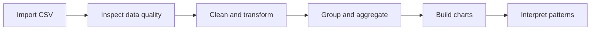

# Google Play Store Apps — Exploratory Data Analysis

**Python · Pandas · NumPy · Matplotlib · Plotly · Data Cleaning · EDA**

## Project overview

An exploratory analysis of the historical **Google Play Store apps dataset (~2018)**. This project examines category distribution, audience content ratings, monetization types (free vs paid), user ratings, listed prices, app sizes and reported installation thresholds. The goal is to identify patterns in sampled app listings through systematic cleaning, aggregation and visualization.

## Questions explored

- Which categories have the highest number of listed apps?
- Do free apps or paid apps dominate this dataset?
- Which content ratings are most frequent?
- How do ratings vary by category and app type?
- How do listed price and app size relate to star ratings?
- How do reported install thresholds compare across categories?

## Dataset

**Original source:** [Google Play Store Apps — Kaggle / lava18](https://www.kaggle.com/datasets/lava18/google-play-store-apps)  
**CSV mirror:** [Historical googleplaystore.csv](https://github.com/atul-aiml/google-playstore-eda/blob/main/googleplaystore.csv)  
**Raw size:** 10,841 records and 13 columns, prior to cleaning.

Main features include `App`, `Category`, `Rating`, `Reviews`, `Size`, `Installs`, `Type`, `Price`, `Content Rating`, `Genres`, `Last Updated`, `Current Ver` and `Android Ver`.

The downloaded source data is excluded from Git; `download_data.py` retrieves it when the analysis is run. All ownership and credit for the dataset belongs to its original publishers.

## Approach



**Data cleaning:** remove malformed rows, filter invalid types, deduplicate app names using the highest review count, preserve missing ratings, parse `Installs` into lower-bound counts, convert `Price` to numeric USD and standardize `Size` to megabytes where available.

**Exploratory analysis:** frequency distributions, grouped category summaries, free-versus-paid comparisons, ratings analysis, installation thresholds and price/size/rating relationships.

## Visualizations

Run the analysis to generate:

| Chart | File |
|---|---|
| Top categories by number of listings | `charts/01_top_categories.png` |
| Free vs paid share | `charts/02_free_vs_paid.png` |
| Content rating distribution | `charts/03_content_ratings.png` |
| Rating histogram | `charts/04_rating_distribution.png` |
| Median reported install threshold by category | `charts/05_median_install_threshold.png` |
| Size vs rating, interactive scatter | `charts/06_size_vs_rating_interactive.html` |
| Paid price vs rating, interactive scatter | `charts/07_paid_price_vs_rating_interactive.html` |
| Free vs paid ratings, interactive box plot | `charts/08_free_vs_paid_ratings_boxplot.html` |


## Repository structure

```text
google-play-store-eda/
├── README.md
├── requirements.txt
├── download_data.py
├── run_analysis.py
├── notebooks/
│   └── google_play_store_analysis.ipynb
├── src/
│   ├── __init__.py
│   └── cleaning.py
├── data/
│   ├── raw/                 # downloaded CSV (not committed)
│   └── processed/           # generated cleaned data (not committed)
└── charts/                   # generated PNG and HTML visualizations
```

## Run locally

Use Python 3.10+ in VS Code, Jupyter, or a terminal:

```bash
python3 -m pip install -r requirements.txt
python3 download_data.py
python3 run_analysis.py
```

Open `notebooks/google_play_store_analysis.ipynb` and run the cells in order to inspect the analysis interactively. The script writes cleaned data locally and exports charts to `charts/`.

## Interpretation & limitations

- **Historical sample:** the data is from approximately 2018; results do not represent the current 2026 market.
- **Install brackets:** entries like `1,000,000+` mean at least that many installs; they do not give exact totals.
- **Missing ratings:** ratings-based results exclude missing ratings, without treating them as zeros.
- **App names:** deduplication by title may inadvertently combine distinct apps with the same title.
- **Causality:** scatterplots describe associations, not evidence that price or size causes ratings.
- **Revenue:** sales and revenue cannot be inferred from listed prices and install brackets.


---
